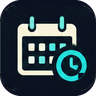

<p align="center"></p>

<h1 align="center">Hewn</h1>

<p align="center"><strong>Honest books, grounded and true.</strong><br>
Free, open-source bookkeeping and payroll on Aleo. Your books stay encrypted on your own device.</p>

<p align="center">
<a href="https://hewnaccounting.com">Website</a> ·
<a href="https://www.hewnaccounting.com">Open the app</a> ·
<a href="BUILD_PLAN.md">Build plan</a> ·
<a href="PROGRESS.md">Progress log</a> ·
<a href="LICENSE">AGPL-3.0</a>
</p>

> **Status: in active development, on Aleo testnet.** Don't keep real books in it yet. Nothing here
> is tax, legal or accounting advice.

---

## What Hewn is

Hewn is a small-business bookkeeping and payroll app. It works the way bookkeepers already
expect: a chart of accounts, double-entry books, invoices, bills, payroll and reports. The
difference is where everything lives:

- **Your books never leave your device.** They are kept in an encrypted vault in your browser.
  There is no Hewn server holding your data, no database and no company account to hack.
- **Your wallet is your bank feed.** Money moves through your Shield wallet on
  Aleo. Hewn reads your wallet's history and asks you what each payment was for, instead
  of having you type transactions in.
- **Payroll is private by design.** Workers are paid in USDCx, a stablecoin, through private Aleo
  transfers. Wages, withholdings, W-4s and paystubs are private in every case. Only hashes and
  commitments ever go on chain.

It is free and open source (AGPL-3.0).

## A tour of the app

Hewn has two sides in one app: a **business** keeps its books and runs its team, and a **worker**
gets their schedule, clocks hours and keeps their paystubs. One Shield account holds one kind.

### The business side

| Tab | What it's for |
|:---:|---|
| <br>**Dashboard** | Where the business stands today: cash, what customers owe, what you owe, and your Shield balances (ALEO and USDCx, private and public). Keep money in **set-asides** (an equipment fund, say) without moving it. |
| <br>**Transactions** | A **For review** list built from your wallet history: accept, exclude, change or undo each payment. The register of every entry and the chart of accounts. |
| <br>**Sales** | Customers, estimates, invoices with sales tax, and payments received (partial, or several invoices at once). |
| <br>**Expenses** | Vendors (with a 1099 flag), bills, paying bills and spending. |
| <br>**Payroll** | Pay runs with federal withholding (IRS annualization), the **team**, **Schedule** and **Hours**, and withholding owed. Timecards feed the pay run directly: regular hours, overtime, callouts and on-call days each get their own paystub line. |
| <br>**Schedule (under Payroll)** | An Outlook-style **team calendar**: a month of day squares with everyone's shifts and on-call days, and tap a day for its hours. Publish a week once and the whole team sees it; each person confirms their own days. |
| <br>**Projects** | Projects, classes and locations, to track income and costs by job or place. |
| <br>**Reports** | Profit and loss, balance sheet, trial balance, who owes what, project profitability and sales tax, with period comparisons. |
| <br>**Taxes** | Sales tax, payroll tax and 1099s: what you've collected and what you owe. |
| <br>**Jobs** | Post openings to the public **job board** (on chain, readable by anyone), feature them, read applications with resumes, interview, and send job offers. Offers carry the pay, the work week and overtime rules, on-call pay and the callout minimum. |
| <br>**Messages** | A private, end-to-end sealed conversation with each person, and announcement channels to the whole team. |
| <br>**Settings** | The business, its fiscal year and its `name.hewn`, and the linked Shield account. The menu also has **Download a backup** of the encrypted vault, and **Log out**. |

### The worker side

| Tab | What it's for |
|:---:|---|
| <br>**Home** | Clock in and out (or clock in for a callout on an on-call day), your employers, today's status and your latest paystub. |
| <br>**Schedule** | The team calendar, with your own shifts standing out, and **My week** to confirm your days or ask for a change. |
| **Offers** | Job offers waiting for you: read the terms, accept, or ask for changes. |
| <br>**Find work** | The public job board. Apply with a message and a resume (there's a builder if you don't have one). |
| **Applications** | Everywhere you've applied, and where each one stands. |
| <br>**Messages** | Your conversations with each employer, and their team announcements. |
| **Hours** | Your punches by day. Fix a shift before it's sent, then **Update weekly timecard**; once sent, a shift is confirmed and locked. |
| <br>**Paystubs** | Every paystub, kept privately on your device, with one line per kind of pay. |
| **Profile** | The `name.hewn` employers know you by, and the profile behind it. |

Every business and worker registers a **`name.hewn`**, so people find each other by name rather
than by a long wallet address. Anyone can also see the public [job board](https://www.hewnaccounting.com/board)
and the [traction map](https://www.hewnaccounting.com/traction) (where people have opened Hewn,
by country, with no account).

## How it works

```
 Your device                                         Aleo (testnet)
┌──────────────────────────────────────┐            ┌───────────────────────────┐
│  Hewn (web app, runs in the browser) │            │  Leo programs:            │
│                                      │  signed in │  names, agreements, USDCx │
│  Encrypted vault (IndexedDB)         │  Shield    │  pay, receipts, sealed    │
│   books · payroll · hours · paystubs ┼───────────▶│  letters, job board       │
│                                      │            │                           │
│  Shield wallet history ──────────────┼◀───────────┤  public state holds only  │
│   → "For review" list                │   reads    │  hashes and commitments   │
└──────────────────────────────────────┘            └───────────────────────────┘
```

- **The vault.** A random AES-256-GCM key encrypts your books. Your username and passphrase only
  unlock that key (PBKDF2-SHA256, 600k rounds); they are never sent anywhere. "Stay logged in"
  keeps an unlocked key on the device for at most 24 hours. A lost passphrase can't be recovered
  yet: keep backups.
- **The wallet.** Shield is the only wallet. Every on-chain action is signed in Shield, so you
  always see what you are signing. One Shield account holds one kind of account (a business or a
  worker), so business and personal money never mix.
- **Payroll.** Hewn works out gross pay, withholding and net pay on your device, from the hours
  on each person's weekly timecard (overtime, callouts and on-call days included, as agreed in
  their offer). It then pays each worker with a private USDCx transfer from your wallet.
- **Letters.** Offers, timecards, schedules, paystubs and messages travel between the two parties
  as sealed **letters**: private Aleo records, encrypted with a key only the employer and that
  worker can derive. Team announcements and the team calendar go to a channel whose key only the
  team holds. Each person on the shared calendar is tagged by a one-way value, never by their key.
- **The job board** is public on purpose: a posting, its pay range if given, and how to apply.
  Applications are sealed letters to the business, never on the board.

## Where it came from

Hewn has been built on the side, for free, over a few years, alongside a full-time job. In the
peak seasons at work, building stopped; when time opened up again, it picked back up where it left
off. Joshua Day, who started it, tells it best:

> It started as "I want to learn more about blockchain." Then I wanted a say in where this
> technology goes, instead of leaving it to big businesses to decide for us. Then it became
> "I wonder if I could build something myself." Slowly, it turned into this.

**Learning (late 2023 to 2024).** It began around the time Aleo opened up to builders, with
months in the developer docs learning how zero-knowledge proofs, Leo and private records
actually work: transitions, async finalize code, and how Leo compiles down to Aleo's own
instruction language. No course teaches that; the language was only a few years old. AI
assistants weren't much help yet either: they had so little to draw on that they kept writing
Rust instead of Leo.

**Learning by building: Proven National Workers (February 2025).** The best way to really learn
it was to build something real and figure it out along the way. The first design, PNW, was huge: a
union-style network for citizen and immigrant workers, with on-chain payroll, worker-run
local DAOs, farm investment co-ops, family trust funds, a farm-to-table marketplace, and
bridges to Stellar, Aztec and Ethereum-style chains. Hundreds of commits went into Leo contracts
and a whitepaper in its first month.

**Narrowing down (2025).** Building it taught what mattered. The second version kept two chains:
private payroll records on Aleo and USDC payouts on Stellar, with NFT paystubs. More than a
thousand commits went in that spring. A sovereign sidechain for governance and a pegged wage token
were sketched, then set aside. Every cut made the core clearer: private, honest payroll. Then
work's busy season took over: the summer slowed down, and the project rested through the end
of the year.

**Starting over, on Aleo alone (2026).** Back at it in January, with a clean rebuild: Aleo only,
paid in USDCx, wages and identities never public, and one adapter as the only path to the chain.
A web portal for employers and workers followed in March.

**First private payroll on testnet (April 10, 2026),** during the Aleo Buildathon. A full
run from the portal: check the agreement, pay in USDCx privately, mint paystub receipts for both
sides, anchor an audit record, then mint the payroll cycle NFT (transactions below). Shield's
in-browser prover handles one program per proof best, so payroll runs as a series of small
transactions.

AI tools have come a long way since those first months, and they help a lot now. They don't
replace knowing how the system works, though: each step past "vibe coding" came from
understanding Aleo well enough to catch what the tools got wrong.

**Hewn (October 2026).** Payroll alone wasn't enough: small businesses need their books.
The portal's libraries were moved into this repository and rebuilt into a full bookkeeping app:
wallet-first, kept in an encrypted vault on your device, open source under the AGPL. It keeps
PNW's privacy rules, its Leo programs and its tax engine. Within weeks it grew the rest of what a
small business runs on: sealed messaging and team announcements, a public job board with
applications and resumes, weekly timecards that feed payroll, overtime, on-call pay and callouts,
and a shared team calendar. By late October 2026 that came to about 81,000 lines of code
(16,000 of them tests) and 9,000 lines of Leo.

**Next: mainnet.** `.hewn` names are planned as a top-level domain in the
[Aleo Name Service](https://aleonames.id), so they resolve across the Aleo ecosystem. See
[`BUILD_PLAN.md`](BUILD_PLAN.md#mainnet-names-hewn-under-the-aleo-name-service-design-joshua-2026-10-15).

<details>
<summary>The first private payroll on testnet (April 10, 2026)</summary>

| Step | Program | Transaction |
|:---:|---|
| Verify agreement | `employer_agreement_v4` | `at1mydsktdsr8pk7d4utzrp6n2rvtgkkpavthukyt4kpdadgyx5lg8sgljea3` |
| Transfer USDCx | `test_usdcx_stablecoin` | `at1yphn8n9zejqnnsktuev7rl9vkv8styq00rjpffa0h7rxnccssyyqdk9ltw` |
| Mint receipts | `paystub_receipts` | `at1w86wy80c9sgv0e2ukwlzja4r4km0vkld2tna586t9447q6pjvvrqhuvnw4` |
| Anchor event | `payroll_audit_log` | `at1jp6mertn92hpn79uak8vdy9t4ha2t0f4fwq877uy6rmjl20g0syqdzygp3` |
| Mint cycle NFT | `payroll_nfts_v2` | `at1d8ht598hqqjgmqfxjwvt0cf47aqafgynzjhazhtreze6j22hzcrq5992r5` |

</details>

"PNW" lives on as the company and protocol namespace: the internal packages are named `@pnw/*`.

## Finding your way around

| Path | What's there |
|---|---|
| [`apps/business`](apps/business) | **The Hewn app** (Next.js). Screens in `src/app`, book logic in `src/books`, everything that touches Aleo in `src/chain` |
| [`apps/site`](apps/site) | The marketing site, hewnaccounting.com |
| [`packages/`](packages) | Shared libraries: the ledger, vault, payroll, tax engine, wallet, Aleo adapter and more. Layering map in [`packages/README.md`](packages/README.md) |
| [`brand/`](brand) | Logo source art and the script that builds the brand assets. The name and colours live in [`packages/brand`](packages/brand) |
| [`docs/`](docs/README.md) | Design documents with their status: the [threat model](docs/THREAT_MODEL.md), [letters](docs/LETTERS.md), the [job board](docs/JOB_BOARD.md), the [audit design](docs/AUDIT_DESIGN.md), and the grant proposal |
| [`archive/`](archive/README.md) | Retired code, kept as it was: the Julia tax engine, the salvage script, four salvaged packages nothing uses |
| [`BUILD_PLAN.md`](BUILD_PLAN.md) | The spec: phases, deliverables and exit criteria |
| [`PROGRESS.md`](PROGRESS.md) | A dated log of every change, with test counts |
| [`CLAUDE.md`](CLAUDE.md) | The project's rules: privacy floor, key handling, boundaries |
| [`CONTRIBUTING.md`](CONTRIBUTING.md), [`SECURITY.md`](SECURITY.md) | Running it, the rules in short, forking, and how to report a problem privately |
| [`pnw_mvp_v2`](https://github.com/PNWBNW/pnw_mvp_v2) (submodule) | **The Leo programs** (the on-chain side) and the deployed-program manifest |
| [`pnw_employment_portal_v1`](https://github.com/PNWBNW/pnw_employment_portal_v1) (submodule) | The original PNW portal, retired on 2026-10-13. Its libraries became `packages/`; its README points here |

Two rules worth knowing before you change code:

- **Chain code stays in `apps/business/src/chain`.** The ledger, vault, reports and payroll never
  import the wallet or Aleo packages. A test (`fiat_boundary.test.ts`) enforces this.
- **Deployed Leo programs are never edited.** Changes ship as a new version.

## Running it locally

You need Node 22 (what CI uses) and pnpm 10.

```bash
git clone https://github.com/PNWBNW/hewn.git
cd hewn
pnpm install
pnpm test            # the whole test suite (vitest)
pnpm build           # strict typecheck of every package, then the app builds
pnpm dev:business    # the app on http://localhost:3000
pnpm --filter @pnw/business build:static   # the installable app's bundle, in apps/business/out
```

The app needs no settings to run. The optional ones are the courier's pinning key (see
`apps/business/.env.example`; copy it to `.env.local`, which is gitignored) and, on the website,
the Upstash store behind the traction map (`KV_REST_API_URL` and `KV_REST_API_TOKEN`, set by
Vercel when the store is connected). Never commit a `.env` file or any key.

The submodules are fetched over HTTPS and only needed for the chain side:
`git submodule update --init pnw_mvp_v2` brings in the Leo programs.

To use the app fully you'll need the Shield wallet on Aleo testnet. Open the app inside Shield's
browser on a phone, or with the Shield extension on desktop.

## Security

Read [`docs/THREAT_MODEL.md`](docs/THREAT_MODEL.md) for what Hewn protects, from whom, and what
it can't. If you find a security problem, please report it privately (the repository's
Security tab, or contact the maintainer) rather than in a public issue.

## License

Copyright (C) 2025-2026 Joshua Daniel Day.

Hewn is free software: you can redistribute it and/or modify it under the terms of the
**GNU Affero General Public License, version 3** (`AGPL-3.0-only`), as published by the Free
Software Foundation. See [`LICENSE`](./LICENSE).

In short: anyone may use, study, change and share Hewn. Anyone who runs a changed copy as a
website or service for other people must offer those people the source of their copy under the
same licence. That is why the app and the site link to the source code.

It is distributed WITHOUT ANY WARRANTY; without even the implied warranty of MERCHANTABILITY or
FITNESS FOR A PARTICULAR PURPOSE. It is not tax, legal or accounting advice.

The **Hewn** name and logo are not covered by this licence. A fork should use its own name and art.
