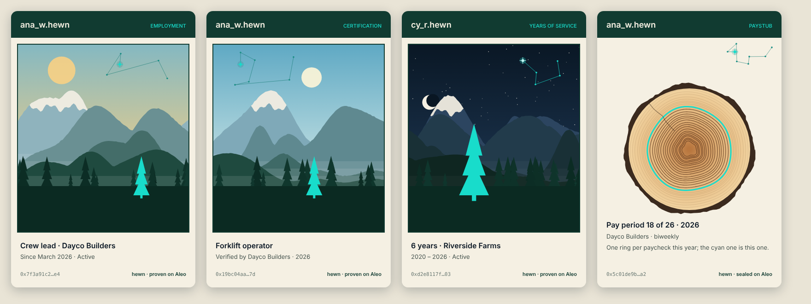
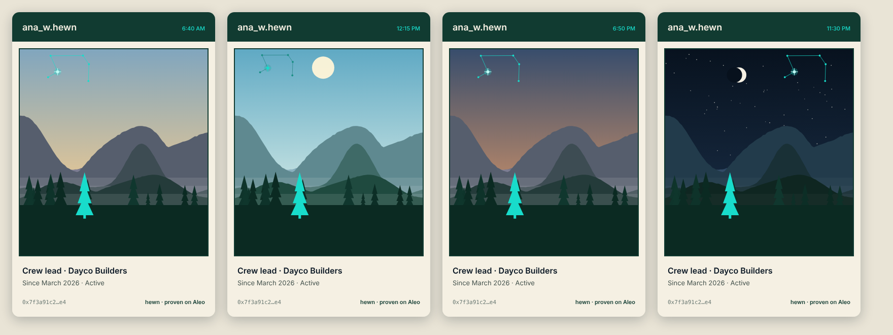
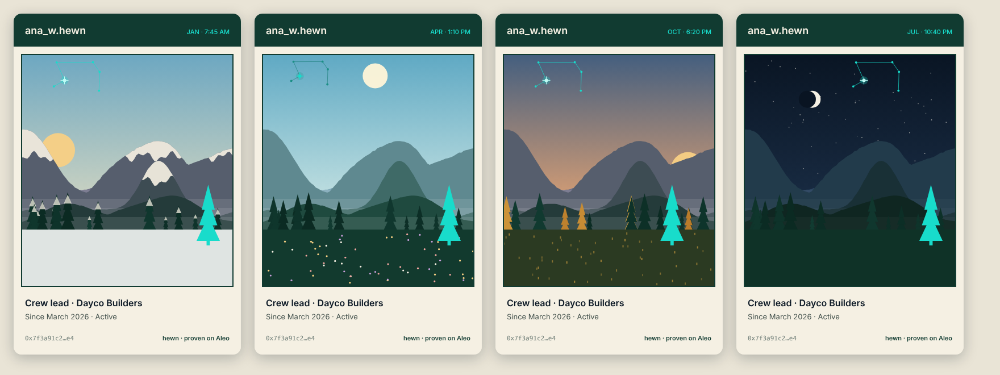
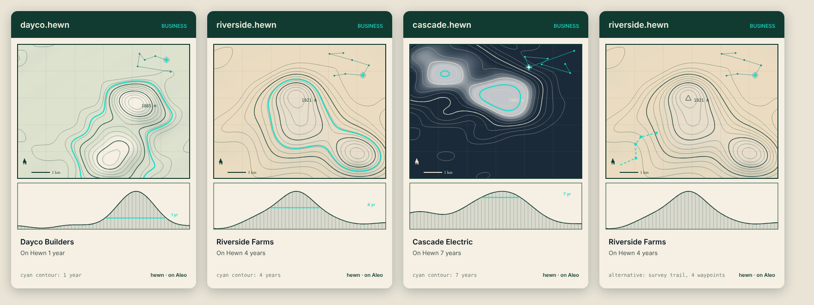

# Hewn art: credential cards and paystub rings

**Status:** design, for review (Joshua, 2026-10-24). Concept sketches only
(`docs/art/concepts-2026-10-24.png`); nothing is in the app yet.

## What it is

Every credential and every paystub gets a picture drawn from its own data, the way PNW's
topographic credential art was (`archive/packages/nft-art`), in Hewn's spirit: the Northwest of the
hero image, layered ridges fading into mist, evergreens, honest materials. The old art's best idea
stays (seeded terrain, so no two are alike); its blueprint look goes.

Cyan is used for three things only, each one meaningful:

| Cyan | Where | What it means |
|---|---|---|
| **The pine** | Credential cards | The logo's pine, standing in the forest. It grows with the person's **time on Hewn** (Joshua, 2026-10-24). Where it stands comes from the hash. |
| **The constellation** | Credential cards and paystubs | The person's **own constellation** (Joshua, 2026-10-24): the same shape on every card and paystub of theirs, drawn from their `name.hewn`. The record lights one of its stars, so the lit star is the record's **fingerprint**. |
| **This ring** | Paystubs | The paycheck in hand, among the year's rings. |

## The credential card

- **The scene:** four ridgelines, far ones pale and blue, near ones deep green, with mist between;
  snow on the highest; a forest along the front; the sun or the moon. Every shape comes from the
  credential's hash, so no two cards share a skyline.
- **The pine:** taller for each year since the person's `name.hewn` was registered. The sketches
  show 1 and 6 years.
- **The constellation:** small, six to eight stars, always in the sky: above the mountains with a
  gap and clear of the sun or moon. Only its place and size change from card to card, never its
  shape. Faint teal by day, glowing cyan at dusk and night.
- **The words:** the `name.hewn`, the kind of credential, the title, the business, the dates, a
  short fingerprint, and "hewn · proven on Aleo".

## A live sky (Joshua, 2026-10-24)

The card is alive: its sky follows the **viewer's own clock**. The sun crosses from east to west
and sets behind the person's ridgeline; at night the moon rises in its real phase for the date and
the stars come out, with the person's constellation glowing among them (faint by day). Ana sees her
morning; a landlord in another time zone sees theirs.

- **The seasons follow the real date** (Joshua): snow down on the low ridges, the trees and the
  meadow in winter, wildflowers in spring, full green in summer, golden larches and dry grass in
  autumn. Northern hemisphere, as the app is. The pine stays cyan in every season: it is the person.
- **No motion** (Joshua, 2026-10-24): nothing drifts or twinkles. The card changes with the clock
  and the date, and is still in between.

- **What never moves:** the landscape, the pine, the constellation's shape and the lit star (the
  fingerprint). Only the sky, the light and the season change, so a card is always checkable.
- **Saved or printed, it freezes at its birth sky** (Joshua): the sky, light and season at the
  moment the credential was issued, so a PDF or an image always looks the same.
- Nothing is sent anywhere: the device's clock and date only; the moon's phase is worked out on
  the device.

## A business's card: its land as a map (Joshua, 2026-10-24)

Joshua's original topographic idea, in Hewn's colours instead of the dark blueprint. A business's
card says only who it is and how long it has been on Hewn.

- **The map** is the business's own land: green-ink contours on cream paper, every fourth one
  heavier, a faint survey grid, a north arrow and a scale bar. The terrain comes from its
  `name.hewn`, so its land is always the same.
- **The cross-section** below, from the original, is cut through the summit and hatched.
- **Time on Hewn is the climbing contour:** one contour is cyan, one level higher for each year on
  Hewn, from the foothills toward the summit, and the same level runs across the cross-section in
  cyan ("4 yr"). No pine on a business's card (Joshua).
- **Its constellation** sits in the map's top corner, from its name, as a person's does.
- **Live, the map's way:** the slopes are shaded from where the sun really is on the viewer's clock
  (east in the morning, west in the evening); at night the map turns to dark paper with cream
  lines. The seasons tint the land: green in spring and summer, ochre in autumn, snow on the high
  ground in winter. No motion. Saved or printed, it freezes at its birth sky like every card.
- **To settle:** past about nine years the cyan contour nears the summit; it could then start a
  second ring low on the mountain, like a second lap.

## The paystub

A hewn log's cross-section: one ring per paycheck this year, the rings still to come faint, this
paycheck's ring cyan (no crack: Joshua, 2026-10-24). The person's constellation sits in the top
corner, with this paystub's star lit. At year end the log is whole: a year-end card. Ring widths come from the paystub's
hash, never from the pay or the hours.

## The constellation and the fingerprint (Joshua, 2026-10-24)

- **The shape is the person's.** All of it comes from their `name.hewn`, so `ana_w.hewn` has
  exactly the same constellation on every credential and every paystub she will ever have. People
  come to know it as hers.
- **The lit star is the record's.** Which of her stars is lit, brighter with a glint, comes from the
  record: for a credential, its public commitment on Aleo; for a paystub, the paystub document's
  hash, which both sides hold (so the business's copy and hers light the same star).
- **The rest of the record's fingerprint is the landscape:** the ridgelines, the snow, the forest and
  where her pine stands all come from the same commitment.
- **Checking it:** anyone can redraw a credential's card from the chain and the name. A card whose
  constellation isn't the name's, or whose landscape or lit star doesn't match the commitment, is
  not genuine.
- **It never changes:** the drawing is a pure function of its inputs (a seeded generator, fixed
  layout, no clock, no `Math.random`), and the renderer is versioned. A change to the art ships as
  `art v2`; a card issued under v1 is always drawn with v1.

## Privacy

What goes in: hashes, the `name.hewn` (public already), the kind of credential, its dates, the
paycheck's number in the year and the time on Hewn. Never a wage, an amount, hours, an address or
an account. Showing a card shows what's written on it and nothing more; the person decides whether
to show it at all.

## Building it

1. **The renderer**, as SVG: deterministic text, testable byte for byte, crisp at any size and in
   PDFs. A package of its own (`packages/art`), with tests that the same input always draws the
   same picture and different inputs don't.
2. **Paystub rings** on the person's Paystubs and the business's paystub view, and in the PDF.
   App only: no Leo.
3. **Credential cards**, which need a credential program: the deployed `credential_nft_v3` and
   `v4` check agreements in `employer_agreement_v4`, so a v5 agreement can't mint one. A new
   program (new Leo, Fable 5.1 at high effort, must-fail tests), then the cards.
4. **A verify page:** paste a card's fingerprint or open its link; the page redraws the
   constellation from the chain and shows whether it matches.

## Open questions

1. Time on Hewn: from the name's registration on chain if the registry keeps the height,
   otherwise from the first agreement.
