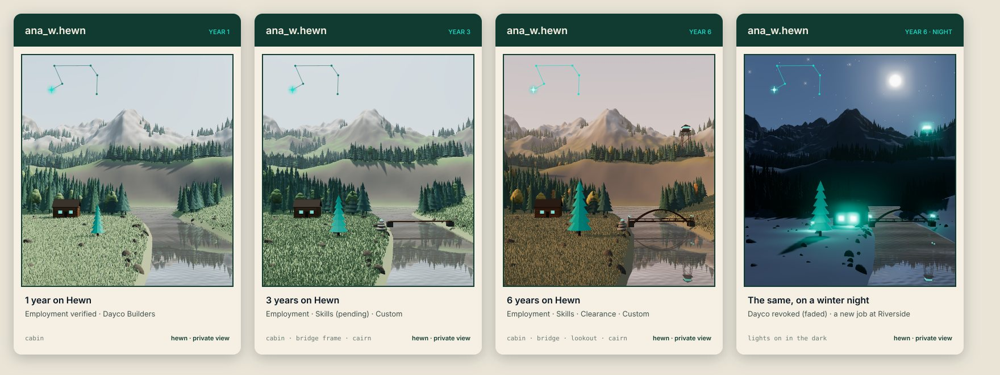
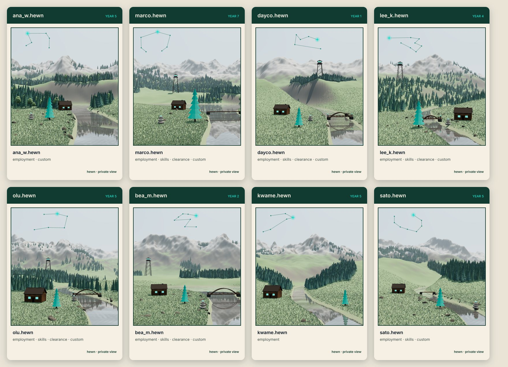
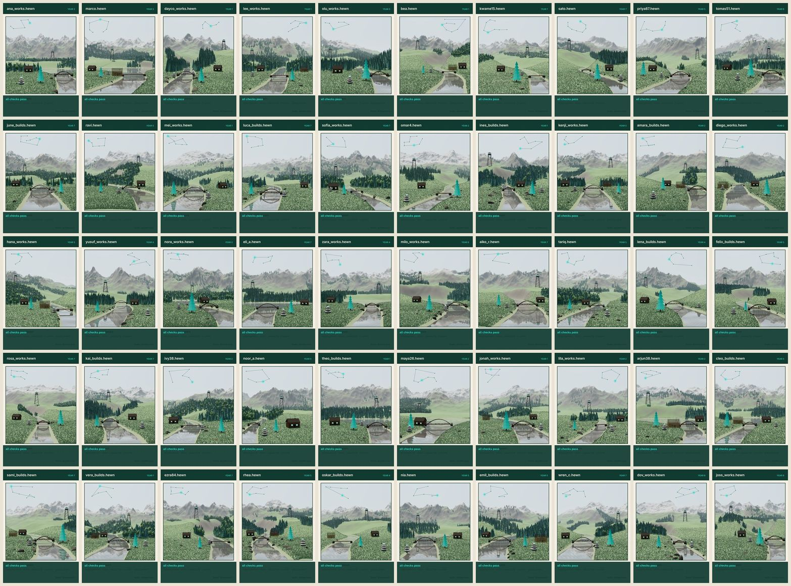
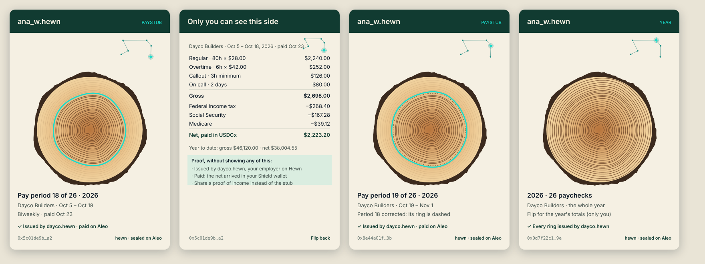

# Hewn art: credential cards and paystub rings

**Status:** design, for review (Joshua, 2026-10-24). Concept sketches and 3D renders only
(`docs/art/`); nothing is in the app yet. The worker's land and its landmarks are settled
(below); the first sketch here is kept for the constellation and the paystub.

## What it is

Every credential and every paystub gets a picture drawn from its own data, the way PNW's
topographic credential art was (`archive/packages/nft-art`), in Hewn's spirit: the Northwest of the
hero image, layered ridges fading into mist, evergreens, honest materials. The old art's best idea
stays (seeded terrain, so no two are alike); its blueprint look goes.

Cyan is used for three things only, each one meaningful:

| Cyan | Where | What it means |
|---|---|---|
| **The pine** | A worker's land | The logo's pine, standing in the meadow. It grows with the person's **time on Hewn** (Joshua, 2026-10-24). Where it stands comes from the hash. |
| **The constellation** | Every card and paystub | The person's **own constellation** (Joshua, 2026-10-24): the same shape on every card and paystub of theirs, drawn from their `name.hewn`. The record lights one of its stars, so the lit star is the record's **fingerprint**. |
| **This ring** | Paystubs | The paycheck in hand, among the year's rings. |
| **The lights** | A worker's landmarks | One small cyan light on each live credential's landmark: the cabin's windows, the bridge's lanterns, the lookout's cab, the cairn's top stone. |

## A worker's land and its landmarks (Joshua, 2026-10-24)

A worker has one land, drawn in 3D: a meadow by a river, forest, foothills and a mountain range,
under the live sky. Their credentials don't each get a separate scene; each one adds a
**landmark** to their land, so the land fills in as their working life does.

| Credential (`packages/records`) | Landmark | Its light |
|---|---|---|
| `employment_verified` | A log cabin in the meadow | Cyan windows |
| `skills` | A bridge across the river | Cyan lanterns at both ends |
| `clearance` | A fire lookout on the highest ridge in view | A cyan band round the cab |
| `custom` | A cairn by the water | A cyan top stone |

- **Status:** active is built and lit. Pending is the bare timber frame: walls and ridge pole
  without logs or roof, the bridge's deck without its arches, the lookout's legs without its cab,
  the cairn without its top stone. Revoked fades to a ghost that stays where it stood: Ana's first
  job is still there, faint, beside the new one. A new credential of the same kind adds another
  (two jobs, two cabins).
- **At night** every live landmark lights the ground round it in cyan; that is when the land looks
  most like the person's.
- **Where each one stands** comes from its credential, so it stands in the same spot on every card,
  every day. Each is placed in view, clear of the pine and the others, never hidden behind them.
- **Private view only:** the landmarks show only to the worker in their own app ("hewn · private
  view"). Their public tenure card, if they show one, is the same land, bare: the river, the
  forest, the range and the pine, nothing about who they work for or what they hold.

### Generated for every name (Joshua, 2026-10-24)

Everything about the land comes from the person's `name.hewn`, so it is theirs and always the
same, and no two names get the same place. Above: eight random names under the same sky and
season, so only the names differ.

- **What the name decides:** how high, sharp and far off the range is, and whether a second range
  stands behind it; the foothills; where the river enters the card (the left, the middle or the
  right, about a third each: Joshua) and its course, width and wander; whether the river comes
  out of a lake at the foot of the range (now and then, about one name in five) or bends out of
  sight (the rest); how wide each side of the valley opens; how much forest, in groves with open meadow
  between (a few thousand trees, never a wall of them); the mix of spruce, fir and leafy trees
  (which turn gold and red in autumn and stand bare of leaves in winter); the boulders.
- **The river shapes the land** (Joshua): the hills and the range part into a valley along its
  course, and the water runs the whole way, so a river never climbs a hill or stops dry.
- **Rules that hold for every name**, found by drawing random names, not by luck:
  - the range is scaled down until the top third of the card is open sky, so the constellation
    always has room;
  - every landmark and the pine are placed in view, apart, out of the water and in sight of the
    viewer: a spot loses points for being off the card, behind another landmark (allowing for how
    wide each is; standing in front of a faded one is fine), in the water or behind a rise in the
    ground, and each keeps the best spot it found; trees don't grow in front of a landmark;
  - the water shows: grass, trees and banks follow the water line, and the river doesn't thin to
    nothing in the distance.
- **Bare slopes are fine** (Joshua): grass and trees don't take on steep ground, so a steep valley
  side can be bare rock and soil.
- **The check:** a script draws 100 random names, each with all four landmarks and about a third
  with a second job and the first one revoked, and measures every card: how much of each landmark
  and the pine is on the card and in sight (from flat-colour renders of each alone and all
  together), how much of the card is water, and whether the constellation found its room. The
  first run passed 47 of 50 (a cabin and a cairn off the card, a cairn behind the pine); after the
  fixes above all 100 pass, the river entering left 32, middle 36, right 32, with 17 lakes. It runs
  again whenever the generator changes, and ships with the renderer.

- **The constellation** is the person's, as everywhere: small, in the open sky, faint teal by day,
  glowing at dusk and night.
- **The words:** the `name.hewn` and "year N" on the band; the time on Hewn and the credentials
  below.

## A live sky (Joshua, 2026-10-24)

The card is alive: its sky follows the **viewer's own clock**. The sun crosses from east to west
and sets behind the person's ridgeline; at night the moon rises in its real phase for the date and
the stars come out, with the person's constellation glowing among them (faint by day). Ana sees her
morning; a landlord in another time zone sees theirs.

- **The seasons follow the real date** (Joshua): snow down on the low ridges, the trees and the
  meadow in winter, wildflowers in spring, full green in summer, golden larches and dry grass in
  autumn. Northern hemisphere, as the app is. The pine stays cyan in every season: it is the person.
- **No motion** (Joshua, 2026-10-24): nothing drifts or twinkles. The card changes with the clock
  and the date, and is still in between.

- **What never moves:** the landscape, the pine, the constellation's shape and the lit star (the
  fingerprint). Only the sky, the light and the season change, so a card is always checkable.
- **Saved or printed, it freezes at its birth sky** (Joshua): the sky, light and season at the
  moment the credential was issued, so a PDF or an image always looks the same.
- Nothing is sent anywhere: the device's clock and date only; the moon's phase is worked out on
  the device.

## A business's card: its land as a map (Joshua, 2026-10-24)

Joshua's original topographic idea, in Hewn's colours instead of the dark blueprint. A business's
card says only who it is and how long it has been on Hewn.

- **The map** is the business's own land: green-ink contours on cream paper, every fourth one
  heavier, a faint survey grid, a north arrow and a scale bar. The terrain comes from its
  `name.hewn`, so its land is always the same.
- **The cross-section** below, from the original, is cut through the summit and hatched.
- **Time on Hewn is the climbing contour:** one contour is cyan, one level higher for each year on
  Hewn, from the foothills toward the summit, and the same level runs across the cross-section in
  cyan ("4 yr"). No pine on a business's card (Joshua).
- **Its constellation** sits in the map's top corner, from its name, as a person's does.
- **Live, the map's way:** the slopes are shaded from where the sun really is on the viewer's clock
  (east in the morning, west in the evening); at night the map turns to dark paper with cream
  lines. The seasons tint the land: green in spring and summer, ochre in autumn, snow on the high
  ground in winter. No motion. Saved or printed, it freezes at its birth sky like every card.
- **To settle:** past about nine years the cyan contour nears the summit; it could then start a
  second ring low on the mountain, like a second lap.

### Issued with the account (Joshua, 2026-10-24)

Every business gets its card automatically when it sets up its account: a **public NFT** on Aleo,
minted in the same setup that registers its `name.hewn`.

- **On chain:** the business's name hash, its owner (public, as a business's name already is) and
  the block height it was issued at, which is where its time on Hewn counts from. The picture is
  drawn from those, by anyone, the same way every time; it is never stored on chain.
- **Testnet:** a small program of its own, `hewn_cards_v1` (staged 2026-10-24 in `pnw_mvp_v2`,
  `src/layer1/hewn_cards_v1.aleo`): one card per business name, checked against the name registry
  (only the name's owner, only a business name, only once). On chain it keeps one entry per card,
  `cards[name_hash] = { issued_at, shown }`, and nothing else. Businesses that already exist claim
  theirs once, from Settings.
- **Time on Hewn counts from the card's issue** (Joshua, 2026-10-24): the block height the card
  was issued at, which anyone can check. An account that existed before the cards starts counting
  when it claims its card; the registry doesn't record when a name was registered.
- **Mainnet:** a business's `name.hewn` will itself be an NFT under the Aleo Name Service (ARC-721),
  so the card can be that NFT's picture: one NFT, not two, shown in every ANS-aware wallet and
  explorer.
- **Bound to the name** (Joshua, 2026-10-24): the card can never be sold or traded on its own. If a
  business ever changes hands, it moves only with its name, through a handover both sides sign,
  and carries a public "under new ownership since" mark. A business sale isn't designed beyond
  this yet: agreements stay tied to the business's wallet (v5), and a new owner would offer each
  worker their terms again.

## A worker's tenure card (Joshua, 2026-10-24)

Workers get a tenure card too, issued automatically at setup like a business's, bound to their
`name.hewn` and never sold or traded.

- **The look:** their land, bare of landmarks (above), with the cyan pine growing with their time
  on Hewn, their constellation in the sky, the live sky and the seasons. People look up at the mountains;
  businesses are the map of the land.
- **What it shows:** their name and their time on Hewn. Never who they work for, their pay, their
  credentials or their jobs: those stay on their private cards.
- **Public or hidden, theirs to switch** (Joshua): a worker chooses at setup whether their card is
  public, and can switch it either way in Settings whenever they like. Public, anyone can see it and
  draw it from their name; hidden, it shows only in their own app. A business's card is always
  public.
- **How hiding works on chain** (Joshua, 2026-10-24: the registry check runs at issue): a
  worker's card is the same one public entry as a business's, `cards[name_hash] = { issued_at,
  shown }`, issued shown or hidden as they choose at setup; `show_card` and `hide_card` flip
  `shown`, and every app draws the card only while it is true. Honest limit, which the app says
  when they switch: issuing the card is a public transaction (the registry check names the name's
  hash and the account, as every registry check does), and the chain keeps its history, so hiding
  stops the card showing from then on but can't erase that it was issued, or that it was shown
  before. What being shown adds is the app's permission to draw the card where the name appears.
- **What being public adds:** only when they joined Hewn. Their name and its account are already
  public on the registry (and on mainnet under the Aleo Name Service).

## The paystub

A hewn log's cross-section: one ring per paycheck this year, the rings still to come faint, this
paycheck's ring cyan (no crack: Joshua, 2026-10-24). The person's constellation sits in the top
corner, with this paystub's star lit. Ring widths come from the paystub's hash, never from the pay
or the hours.

- **Entirely private** (Joshua, 2026-10-24): the face as much as the back. Only the person sees it,
  in their own app, and the business holds its copy. It is never shared or shown publicly. To prove
  income to a landlord or a lender, the person shares a proof (a yes or no, "over $3,000 a month for
  six months"), never the card. Saving or printing gives them a private file of their own, and the
  app says so first.
- **The face:** the log, the constellation, the pay period ("18 of 26 · 2026"), the employer, the
  dates and the pay date, and a check line ("Issued by dayco.hewn · paid on Aleo") shown only once
  the app has checked the record came from that employer through the paystub program.
- **The back** (flip the card): the paystub itself, every pay line, the withholdings, the net paid
  in USDCx, the year to date, and a way to make a proof of income from it.
- **The year-end log:** every ring complete, no cyan ring; "2026 · 26 paychecks" and the employer on
  the face, the year's totals on the back. One log per employer per year.
- **To settle:** the net pay on the face or every amount on the back; a corrected or reversed
  paycheck's ring dashed rather than removed; the season on the bark (snow for a January paycheck),
  fixed at the pay date.

## The constellation and the fingerprint (Joshua, 2026-10-24)

- **The shape is the person's.** All of it comes from their `name.hewn`, so `ana_w.hewn` has
  exactly the same constellation on every credential and every paystub she will ever have. People
  come to know it as hers.
- **The lit star is the record's.** Which of her stars is lit, brighter with a glint, comes from the
  record: for a credential, its public commitment on Aleo; for a paystub, the paystub document's
  hash, which both sides hold (so the business's copy and hers light the same star).
- **The land is the name's; the landmark's spot is the record's.** The mountains, the river and the
  forest come from her `name.hewn`, like the constellation. Where a credential's landmark stands
  comes from its commitment, so the lit star and the landmark's spot together are its fingerprint.
- **Checking it:** the app redraws a card only from a record it has checked (the right program,
  the right issuer), so a card in the app is genuine by being there. A drawing whose constellation
  isn't the name's, or whose landscape or lit star doesn't match the record, is not one of ours.
- **It never changes:** the drawing is a pure function of its inputs (a seeded generator, fixed
  layout, no clock, no `Math.random`), and the renderer is versioned. A change to the art ships as
  `art v2`; a card issued under v1 is always drawn with v1.

## Privacy (Joshua, 2026-10-24)

- **Every card is private:** credential cards and paystubs alike. Each is a private record on
  Aleo; its card shows only in its owner's app (and, for a paystub, the business's copy). Nothing
  about a person is ever shown publicly through their cards. When someone needs to prove something
  (a job, a licence, an income), they share a proof of that one fact, not a card.
- **The exceptions: a business's card is public** (Joshua, 2026-10-24), **and a worker's tenure
  card is public if they choose** (below). It shows only the
  business's name and its time on Hewn, both public already, so anyone can see it (on its job
  postings and its directory listing, say) and redraw it from its name.
- What goes into any card: hashes, the `name.hewn`, the kind of credential, its dates, the
  paycheck's number in the year and the time on Hewn. Never a wage, an amount, hours, an address or
  an account in the art itself.

## Building it

1. **The renderer**, a package of its own (`packages/art`), starting from the prototypes behind
   these renders (`art/prototype/`: the 2D cards, the 3D land and the 100-name checker). Begun
   2026-10-25: the business's map (its one raster a PNG written by hand, the rest lines), the
   paystub's log, the constellation and the sky, as SVG text; Settings draws a business's card
   from it. The same day, the worker's land: `land.ts` is the scene as data (the genome, the
   terrain, the placement, the forest), `land3d.ts` the three.js render, loaded only where a land
   is shown; Settings draws a worker's card (the bare land with the pine; landmarks wait for
   credentials). The business's map and the paystub
   rings are SVG: deterministic text, testable byte for byte, crisp at any size and in PDFs. A
   worker's land is a 3D scene (three.js, pinned, loaded only on the pages that show it). Its
   **scene** is deterministic and tested as data (the same name and records give the same terrain,
   trees and landmark spots; different names don't); the pixels may differ slightly between
   graphics chips, so a saved or printed card is rendered once and kept as an image. Drawing takes
   a few seconds on a phone, so the app draws each card once and redraws it only when the hour or
   the season moves on.
2. **Paystub rings** (2026-10-25): the person's Paystubs and the business's paystub view draw the
   card above the figures (`cards/PaystubCardArt.tsx`). Its place in the year is counted from the
   pay dates each side holds (`books/paystub_rings.ts`: the person's from the paystubs that
   arrived from the same agreement, the business's from its own runs), the paychecks a year from
   the person's schedule on the business's side and from the period's length on the person's.
   Both sides hold the paystub's hash, so both light the same star and cut the same rings. The
   check line says "sealed by … · paid on the rail" on the person's copy (a paystub arrives only
   sealed from that business, and the hash is recomputed as it arrives) and "paid on the rail" on
   the business's once the transfer settled. There is no paystub PDF yet; when one exists the
   card goes in it. App only: no Leo.
   **The cards program**, `hewn_cards_v1`, deployed 2026-10-25, and the app's plumbing for it the
   same day: a new account ends setup by issuing its card (a business's after its name, a worker's
   after their profile, with the shown-or-hidden choice), an account from before the cards claims
   its card once from Settings, a worker switches theirs there (the honest note first), and
   Settings shows "on Hewn since" from the issue block (`chain/cards.ts`, `chain/CardPanel.tsx`,
   `books/card.ts`). The vault keeps a copy of what the chain holds; the chain is the truth.
   **The page anyone can open** (2026-10-25): `/card?name=dayco` draws a name's card from public
   reads alone (the registry for whose name and what kind, `cards[name_hash]` for the card, the
   issue block for the date), with no account and no Shield. A business's card is drawn whenever
   it has one; a worker's only while `shown` is true, and a hidden card reads to a visitor exactly
   like no card ("no public card"). Settings shows the address under the card for sharing
   (`chain/public_card.ts`, `chain/PublicCard.tsx`, `app/card/`).
3. **Credential cards**, which need a credential program: the deployed `credential_nft_v3` and
   `v4` check agreements in `employer_agreement_v4`, so a v5 agreement can't mint one. A new
   program (new Leo, Fable 5.1 at high effort, must-fail tests), then the cards.
4. **Proofs instead of showing:** a person proves one fact from their private records (employed by,
   licensed as, earned over) without showing a card. (The page anyone can open, drawn from a
   name, exists since 2026-10-25: step 2.)

## Open questions

1. One credential opened on its own: the same land with that landmark brought forward and its
   star lit, or a closer view of the landmark.
2. Still rough in the renders: where the hills open round the river some valley sides are bare and
   smooth, and the morning haze greys the range a little.
