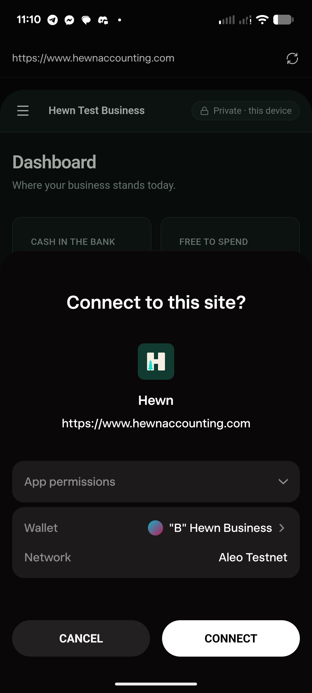

# 2026-10-27: stuck on "Opening…", then fine on its own

**Status: unexplained, resolved by itself.** No cause was found and none is assumed. If it happens
again, see [If it happens again](#if-it-happens-again).

## What happened

Times are Pacific, from Joshua's screenshots and messages.

| Time | Where | What |
|---|---|---|
| 10:11 | Brave on Joshua's phone, on the way to the traction map | `hewnaccounting.com` stayed on "Opening…" (screenshot 1). Closing and reloading did the same. |
| 10:27 | Vercel | Joshua found an old deployment deleted under Vercel's 30-day retention, restored it, and redeployed from `main`. The domains were all valid and Production was the latest build. |
| 10:36 | Brave | The site loaded to the front page. Logging in said the username and passphrase didn't match: Brave had never held these books (they were made in Shield's browser, and each browser keeps its own), so nothing was lost. |
| 10:40 | Shield's browser on the same phone, where the books are | Stuck on "Opening…" (screenshot 2), still after 20 seconds. |
| 10:52 | Shield, on build `80f1858` (#264) | Stuck on "Opening… drawing your books · 80f1858" (screenshot 3): the books had unlocked and decrypted, and the page stopped while the screen was being drawn. `?fresh` reached the login screen, and logging in froze on "Opening…" the same way. |
| between | Brave and Shield | Both apps were force-closed and reopened. It didn't help. |
| 11:10 | Shield | It opened normally: the dashboard drew, with Shield's "Connect to this site?" sheet over it (screenshot 4). Everything has worked since: a backup with the account, a restore from it, the view key added again. |

The books were never at risk: they unlocked every time it was tried, and they were restored from
the account backup afterwards without loss.

## What was looked at, and ruled out

- **Joshua's data.** Books like his (a business with invoices, sales tax, a set-aside, a recorded
  difference, joins, a match and a view key) open and draw fine in a headless browser.
- **The code that runs on the first draw.** Read for any loop that could run forever (the
  menu's counts, the setup check, the jobs' projects, the dashboard's figures, the set-asides, the
  Shield check, hours, key rings); none can on real data.
- **The domains and deployments.** All valid; Production was the newest build.
- **The view key.** It lives inside the encrypted books, so nothing can ask for it before they
  unlock, and the dashboard and the menu never read it.

## What changed while looking

None of these is known to have fixed it, and from what each does, none should have. They were
things worth having that came up along the way.

| PR | Live (Pacific) | What it does |
|---|---|---|
| #263 | ~10:35 | Opening gives each step that reads the browser's storage 8 seconds, then shows the front page instead of waiting forever. (Brave reached the front page after this; it may have helped there, or the redeploy did. It didn't change Shield.) |
| #264 | ~10:48 | The opening screen names its step and the build ("drawing your books · 80f1858"); `?fresh` skips the remembered login. |
| #265 | ~11:08 | A probe: each drawing step notes its name in `localStorage` and clears it once the screen is drawn; the next load shows "Last time the screen stopped at: …". It went live minutes before Shield started working, which is coincidence as far as anyone can tell: it only writes a step's name. |
| #266 | ~11:53 | Unrelated to the freeze: on testnet, the backup card says to turn "Pay network fees privately" off (a backup asked for a private fee fails in Shield before signing). |

Joshua's Vercel restore and redeploy (10:27) also fall in the window.

## If it happens again

1. Don't clear the site's data or uninstall the browser: that deletes the books on the device.
2. Reload without `?fresh`. Under "Opening…" the screen shows the build and, if the last load
   stopped while drawing, **"Last time the screen stopped at: …"**. Screenshot that.
3. `/settings` opens without drawing the dashboard; if it opens, save a backup from there.
4. Bring the screenshot back here: the step it names is where to look.

## Screenshots

| 1. Brave, 10:11 | 2. Shield, 10:40 | 3. Shield, 10:52 | 4. Shield, 11:10 |
|---|---|---|---|
|  |  |  |  |
