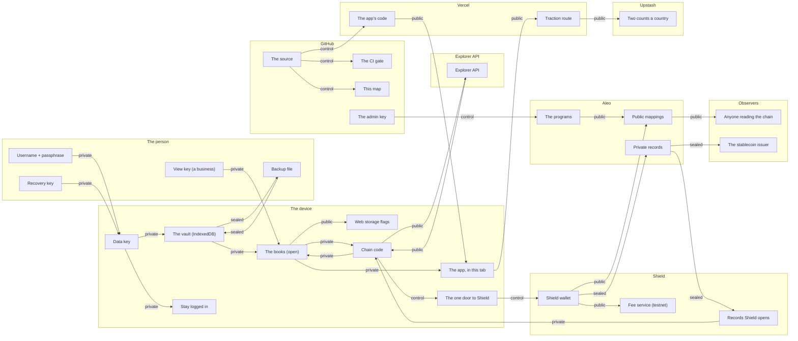

# Data flow: where the data lives and what crosses between places

**Status:** living, generated in part (2026-11-03). The written companion of the **data-flow view
of the map** at [pnwbnw.github.io/hewn](https://pnwbnw.github.io/hewn/#data-flow), the same
graph drawn in 3D (how it's made: [`../map/README.md`](../map/README.md)). This page is for
anyone who can't or won't run the map: an auditor with a checklist, a reader on GitHub. The
tables and the diagram below are generated from [`../map/data/data_flow.json`](../map/data/data_flow.json),
and CI fails when they drift from it; the words around them are written by hand.

It answers the data-flow question an auditor asks first (`COMPLIANCE_MAP.md`, gap 8; SOC 2
CC2.1 and C1; ISO 27001 A.5.9 to A.5.13): every place Hewn's data can be, what each holds, how it
is classed, and every flow between places with what crosses it. Each point and each flow cites the
rule that governs it ([`../INVARIANTS.md`](../INVARIANTS.md)) or the threat it answers
([`../THREAT_MODEL.md`](../THREAT_MODEL.md)).

## The four classes

| Class | Meaning | Where it may be |
|---|---|---|
| **Private** | Plaintext about a person or a business: the books, wages, keys, a passphrase. | The device, in memory, for one session; inside Shield; nowhere else. Never on a server, never on chain. |
| **Sealed** | Ciphertext that may travel: a backup, a letter, a record. Opened only with a key the person holds. | The vault, a backup file, the chain's private records. |
| **Public** | Hashes, commitments, block heights, the app's code, two counts a country. Public on purpose; nothing about a person. | The chain's mappings, Vercel, GitHub, Upstash. |
| **Control** | Not data: a request to sign, a deploy, a fee. Shown or logged where it happens. | Between the app and Shield; between GitHub and the hosts. |

## What to take from it

- **No store outside the device holds plaintext about anyone.** The only server-side store is
  Upstash's two counts per country (INV-05). Vercel serves code and runs one function that adds
  to those counts; it has no database (INV-02).
- **What leaves the device is sealed or public.** A backup and a letter are ciphertext; what the
  chain's public mappings hold is hashes, commitments and heights (INV-03); the explorer sees
  which public entries a page reads, not what the books say.
- **Shield is the second private place.** It holds the account's keys and decrypts the account's
  records for the page on request; every transaction is signed there with what it does shown
  first (INV-11). The app has one module that can reach it.
- **Who can see what, regardless of Hewn:** any host sees requests (an address, which page) as
  hosts do, nothing of the books; anyone reading the chain sees public state and the shape of
  each transaction; the stablecoin's issuer receives a compliance record of every private USDCx
  transfer, by the token's own design (`../ALEO_CONSTRAINTS.md` §4).
- **What this page doesn't cover:** a compromised device or browser, which sees what the person
  sees (T8), and look-alike sites (`../THREAT_MODEL.md`, "Not yet covered").

<!-- map:data-flow:start -->

_Generated from `docs/map/data/data_flow.json` by `node docs/map/build.mjs --doc`; CI checks it is current. Edit the data, not this block._

### Where the data lives

#### The person

What only the person holds: the passphrase, the recovery key, a backup they saved.

| Point | Kind | Class | What it holds | Rules |
|---|---|---|---|---|
| Username + passphrase | key | Private | Typed at login, held in memory only. Never stored, never sent, never verified anywhere. | [INV-07](../INVARIANTS.md) [INV-09](../INVARIANTS.md) |
| Recovery key | key | Private | Shown once when made, kept by the person. The only way back from a lost passphrase. | [INV-09](../INVARIANTS.md) |
| Backup file | artifact | Sealed | The vault's ciphertext as a file, saved through the phone's share sheet or a download. Useless without the username and passphrase. | [T2](../THREAT_MODEL.md) [T19](../THREAT_MODEL.md) |
| View key (a business) | key | Private | Typed once in setup or Settings so the books can read the business's incoming private payments. Kept only inside the encrypted books; never sent, logged or shown back. | [INV-06](../INVARIANTS.md) [T20](../THREAT_MODEL.md) |

#### The device

The browser that holds the books: the encrypted vault, the books open in memory for one session, the app's code.

| Point | Kind | Class | What it holds | Rules |
|---|---|---|---|---|
| The app, in this tab | process | Control | The ledger, payroll, sales and reports, running in the page. Code only; it carries no data of its own. | [INV-16](../INVARIANTS.md) |
| The books (open) | store | Private | The plaintext books: entries, team, wages, invoices. In memory for this session only. | [INV-01](../INVARIANTS.md) [INV-02](../INVARIANTS.md) |
| Data key | key | Private | A random AES-256-GCM key, non-extractable, that encrypts the books. Wrapped by the unlock secret; never stored in plaintext. | [INV-07](../INVARIANTS.md) |
| The vault (IndexedDB) | store | Sealed | The books as ciphertext. The one durable store on the device. | [INV-10](../INVARIANTS.md) [T2](../THREAT_MODEL.md) |
| Stay logged in | store | Private | The open data key, non-extractable, for at most 24 hours from login. Forgotten on Log out. | [INV-08](../INVARIANTS.md) |
| Web storage flags | store | Public | Five flags and nothing else: an account exists here, this device was counted, the step a load stuck at. Never a name, a number or an id. | [INV-10](../INVARIANTS.md) |
| Chain code | process | Control | The part of the app that talks to Shield and the explorer. Loads only on the pages that need it. | [INV-16](../INVARIANTS.md) [INV-17](../INVARIANTS.md) |
| The one door to Shield | process | Control | The single module that touches the wallet adapter. Nothing else in the app can send a transaction. | [INV-11](../INVARIANTS.md) |

#### Shield

The wallet app on the phone. It holds the account's keys, signs every transaction and shows what is being signed.

| Point | Kind | Class | What it holds | Rules |
|---|---|---|---|---|
| Shield wallet | key | Private | The account's private key and view key, in Shield. Every transaction is signed here, with what it does shown first. | [INV-11](../INVARIANTS.md) |
| Records Shield opens | store | Private | The account's private records (letters, backups, USDCx), decrypted by Shield with its view key and handed to the page on request. | [INV-01](../INVARIANTS.md) |
| Fee service (testnet) | service | Public | On testnet Shield pays the network fee, publicly. A private fee fails there (the backup note in Settings). | [T3](../THREAT_MODEL.md) |

#### Aleo

The network: private records only their owner can open, and public mappings that hold hashes, commitments and heights.

| Point | Kind | Class | What it holds | Rules |
|---|---|---|---|---|
| Private records | store | Sealed | Letters (paystubs, invoices, messages), backups of the books, agreements, credentials, USDCx. Only the owner can open them. | [INV-01](../INVARIANTS.md) [INV-03](../INVARIANTS.md) |
| Public mappings | store | Public | Name hashes, commitments, statuses, block heights, anchored period roots. Never an amount, a name or a memo; never a running total. | [INV-03](../INVARIANTS.md) [INV-23](../INVARIANTS.md) |
| The programs | process | Public | Deployed and immutable. A change is a new version with a migration note. | [INV-20](../INVARIANTS.md) [INV-22](../INVARIANTS.md) |

#### Explorer API

Provable's public read API: mappings and transaction status. The only chain reads the app makes.

| Point | Kind | Class | What it holds | Rules |
|---|---|---|---|---|
| Explorer API | service | Public | Mapping reads and transaction status, public data. It can see which names and addresses a page looks up. | [T3](../THREAT_MODEL.md) |

#### Vercel

Serves the app's code. One API route, for the traction counts. Sees requests like any host; holds no data.

| Point | Kind | Class | What it holds | Rules |
|---|---|---|---|---|
| The app's code | artifact | Public | The website build, served with one security policy for the whole app. No database, no API that sees plaintext. | [INV-02](../INVARIANTS.md) [INV-17](../INVARIANTS.md) |
| Traction route | process | Public | The one server function. It receives a country and a yes/no and adds to two counts. No date, address or id. | [INV-05](../INVARIANTS.md) |

#### Upstash

Two counts per country since launch: visits and visitors. Nothing else.

| Point | Kind | Class | What it holds | Rules |
|---|---|---|---|---|
| Two counts a country | store | Public | Visits and visitors per country since launch. The only data Hewn keeps on any server, and the only exception to INV-02. | [INV-05](../INVARIANTS.md) [T11](../THREAT_MODEL.md) |

#### GitHub

The source, the CI gate, this map, and the one secret that deploys programs (in the chain repository).

| Point | Kind | Class | What it holds | Rules |
|---|---|---|---|---|
| The source | artifact | Public | AGPL-3.0. Every change is one pull request, merged after Joshua approves it in session. | [OPS-01](../INVARIANTS.md) [OPS-08](../INVARIANTS.md) |
| The CI gate | process | Control | Tests, the rule checks, the build, the dependency audit, on every pull request. Read-only, no secrets. | [OPS-04](../INVARIANTS.md) [OPS-05](../INVARIANTS.md) |
| This map | artifact | Public | Built from the tree on every push to main and published on GitHub Pages. | [OPS-05](../INVARIANTS.md) |
| The admin key | key | Private | The key that deploys and upgrades the programs, only in the chain repository's environment secret, read by manual workflows that print a redacted form. | [OPS-03](../INVARIANTS.md) [T18](../THREAT_MODEL.md) |

#### Observers

Who sees what regardless of Hewn: anyone reading public state, and the stablecoin issuer's compliance record.

| Point | Kind | Class | What it holds | Rules |
|---|---|---|---|---|
| Anyone reading the chain | service | Public | Sees every public mapping and the shape of every transaction: which program, when, the fee. Not who, not how much. | [INV-03](../INVARIANTS.md) [T6](../THREAT_MODEL.md) |
| The stablecoin issuer | service | Public | Receives a compliance record of every private USDCx transfer, by the token's own design. The one party outside the two accounts that sees a payment. | [T6](../THREAT_MODEL.md) |

### What crosses between them

| From | To | What crosses | Class | Rules |
|---|---|---|---|---|
| Username + passphrase | Data key | PBKDF2-SHA256, 600k rounds, wraps and unwraps the data key | Private | [INV-07](../INVARIANTS.md) |
| Recovery key | Data key | a second wrapped copy of the data key, for a lost passphrase | Private | [INV-09](../INVARIANTS.md) |
| Data key | The vault (IndexedDB) | encrypts the books into the vault and opens them from it | Private | [INV-07](../INVARIANTS.md) |
| The vault (IndexedDB) | The books (open) | the books, opened in memory for this session | Private | [INV-02](../INVARIANTS.md) |
| Data key | Stay logged in | kept non-extractable for at most 24 hours | Private | [INV-08](../INVARIANTS.md) |
| The books (open) | The app, in this tab | the ledger, payroll and reports read and post entries | Private | [INV-16](../INVARIANTS.md) |
| The books (open) | Web storage flags | five yes/no flags, never data | Public | [INV-10](../INVARIANTS.md) |
| The vault (IndexedDB) | Backup file | the sealed record itself, written out through the share sheet | Sealed | [T19](../THREAT_MODEL.md) |
| Backup file | The vault (IndexedDB) | restored on any device, opened with the username and passphrase | Sealed | [T2](../THREAT_MODEL.md) |
| View key (a business) | The books (open) | typed once, kept inside the encrypted books | Private | [T20](../THREAT_MODEL.md) |
| The books (open) | Chain code | what to send: a payment, a letter, a backup, an anchor | Private | [INV-16](../INVARIANTS.md) |
| Chain code | The one door to Shield | a transaction to sign | Control | [INV-11](../INVARIANTS.md) |
| The one door to Shield | Shield wallet | the request, shown in Shield before it is signed | Control | [INV-11](../INVARIANTS.md) [INV-12](../INVARIANTS.md) |
| Shield wallet | Private records | signed transactions that make or consume private records: letters, backups, payments | Sealed | [INV-01](../INVARIANTS.md) |
| Shield wallet | Public mappings | signed transactions that write a hash, a commitment or a status | Public | [INV-03](../INVARIANTS.md) |
| Shield wallet | Fee service (testnet) | the network fee, paid publicly on testnet | Public | [T3](../THREAT_MODEL.md) |
| Records Shield opens | Chain code | the account's records, opened by Shield, read on request: letters, the backup, the balance | Private | [INV-01](../INVARIANTS.md) |
| Private records | Records Shield opens | records Shield scans and decrypts for the account | Sealed | [INV-01](../INVARIANTS.md) |
| Chain code | Explorer API | mapping reads and transaction status; the lookups themselves are visible to the API | Public | [T3](../THREAT_MODEL.md) |
| Explorer API | Chain code | public state: name hashes, statuses, heights, confirmations | Public | [INV-03](../INVARIANTS.md) |
| Chain code | The books (open) | the feed: payments to review, letters opened, a backup restored | Private | [INV-02](../INVARIANTS.md) |
| The app's code | The app, in this tab | the app's code, and nothing back | Public | [INV-02](../INVARIANTS.md) [INV-17](../INVARIANTS.md) |
| The app, in this tab | Traction route | once per device: a country and a yes/no, no id | Public | [INV-05](../INVARIANTS.md) |
| Traction route | Two counts a country | adds one to two counts | Public | [INV-05](../INVARIANTS.md) |
| The source | The CI gate | every pull request | Control | [OPS-08](../INVARIANTS.md) |
| The source | The app's code | a deploy on every merge | Control | [OPS-01](../INVARIANTS.md) |
| The source | This map | this map, rebuilt on every push to main | Control | [OPS-05](../INVARIANTS.md) |
| The admin key | The programs | a deploy or an upgrade, run by hand | Control | [OPS-03](../INVARIANTS.md) [INV-20](../INVARIANTS.md) |
| The programs | Public mappings | the only writer of public state | Public | [INV-03](../INVARIANTS.md) |
| Public mappings | Anyone reading the chain | hashes, commitments, heights; the shape of each transaction | Public | [INV-03](../INVARIANTS.md) |
| Private records | The stablecoin issuer | a compliance record of each private USDCx transfer | Sealed | [T6](../THREAT_MODEL.md) |

### The same, drawn

Lines are labelled with the class of what crosses them.

<!-- map:data-flow:end -->

## Keeping it true

A new place for data, or a new flow, is a change to `docs/map/data/data_flow.json` in the same
pull request as the code, with the rule it cites. `node docs/map/build.mjs --doc` rewrites the
block above; CI (`node docs/map/build.mjs --check`) fails when the block is stale, when a flow
names an unknown point, or when a rule id isn't in the invariants or the threat model.
